# ARCTIC FOX 🦊

**Cybersecurity Developer · Offensive Security · OSINT · Linux**

---

## About

I build practical tools for cybersecurity, Linux, privacy, and open-source workflows. My work focuses on turning technical ideas into useful applications, improving system administration workflows, and learning through hands-on security research.

- **Cybersecurity:** security tooling, authorized testing, and defensive awareness
- **OSINT:** public-source research and information discovery
- **Linux:** Kali Linux, Debian-based systems, and Bash automation
- **Development:** Python applications, command-line utilities, and desktop GUI tools
- **Principles:** responsible research, clear documentation, and safer software

## Featured Projects

| Project | Description | Technologies |
|:---|:---|:---|
| [**GitHub Search**](https://github.com/arcticfox-cyber/GitHub-Search) | Desktop GUI and CLI for searching GitHub users, inspecting public profiles and repositories, cloning projects, and exporting reports. | Python · Tkinter · GitHub API |
| [**Arctic Fox Anonymity**](https://github.com/arcticfox-cyber/Arctic-Fox-Anonymity) | Transparent Tor-routing toolkit for Kali Linux, with firewall management, DNS routing, status checks, and identity-change commands. | Bash · Tor · iptables |
| [**Kali Uninstaller**](https://github.com/arcticfox-cyber/Kali-Uninstaller) | GUI utility for browsing installed packages, inspecting package details, and removing selected software through APT. | Python · Tkinter · APT |

## Technologies & Tools

**Languages & Development**

**Security & Networking**

## Repository Languages

## Current Interests

- Building reliable Linux utilities and desktop applications
- Improving Python and Bash automation
- Exploring web, network, and application security
- Developing responsible OSINT workflows
- Writing clear installation guides and technical documentation

## Connect

**Think clearly. Research responsibly. Build useful tools.**

> Projects are intended for education, authorized security testing, and ethical research.

